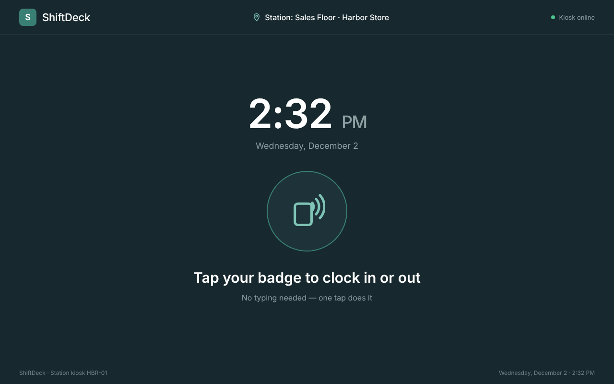
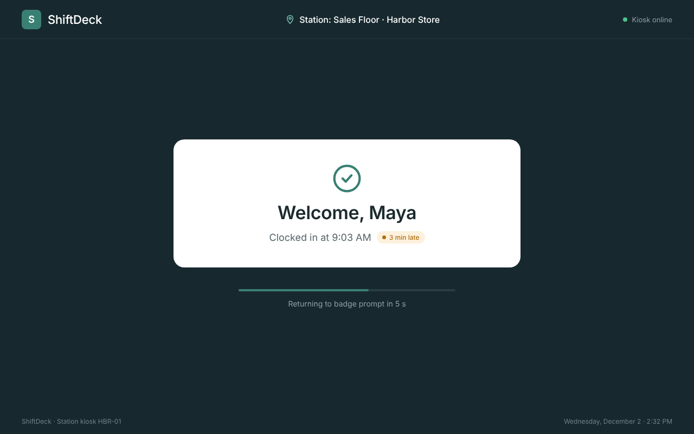
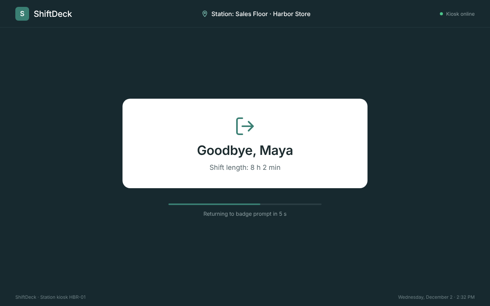
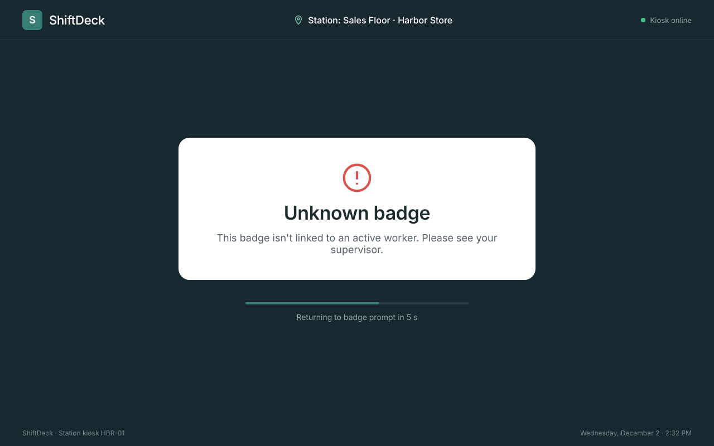
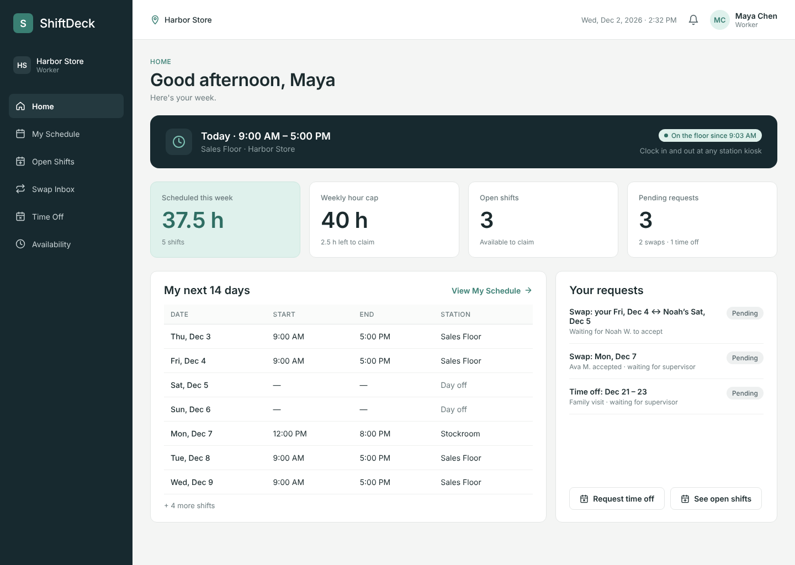
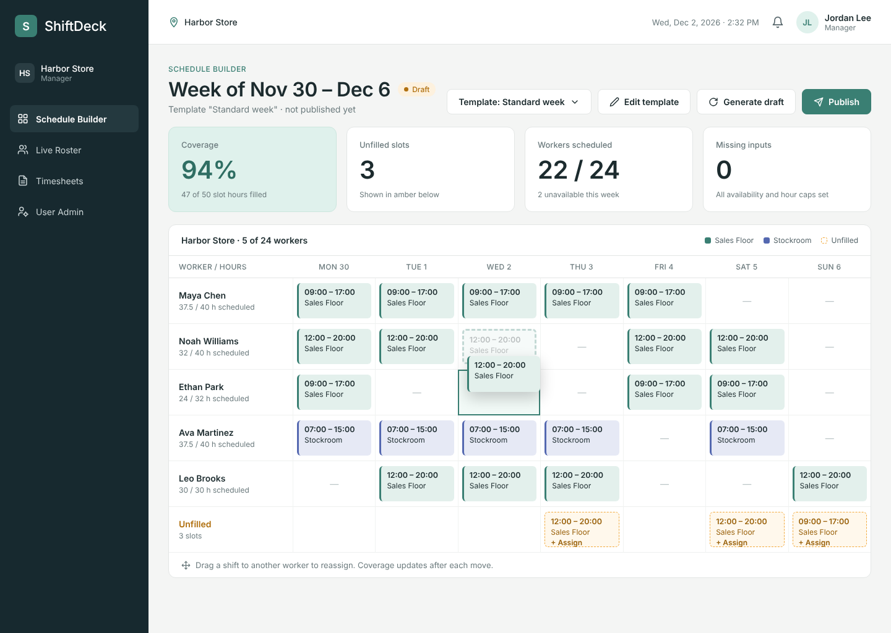
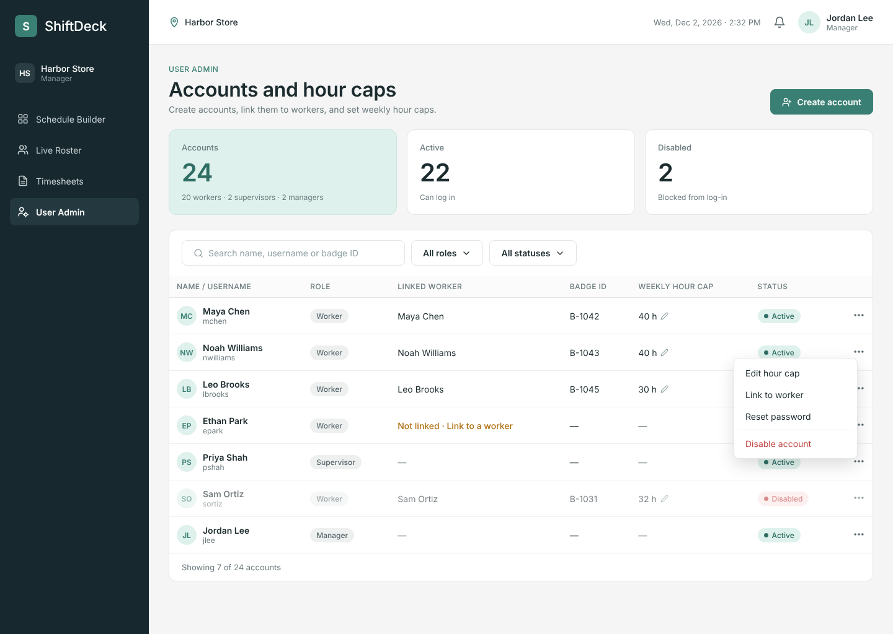

# UI Mockups

These match Section 9 of the Step 1–2 report. Each screen is labelled with its ID from [`REQUIREMENTS.md` §4.1](./REQUIREMENTS.md#41-user-interfaces), and the screen and menu names match the web dialog map ([`uml/img/dialog-map-web.svg`](./uml/img/dialog-map-web.svg)).

> **Figma source:** link to be added. The editable source is a Figma file ("ShiftDeck UI Mockups"); the images below are exports of the same screens.

Ground rules the mockups follow (use them when building the real pages):

- The product name is **ShiftDeck** everywhere.
- Only three roles exist: **Worker, Supervisor, Manager**.
- Clocking happens **only at the kiosk, with one badge tap** (FR-2.1.2, NFR-1.2). No page has a Clock in / Clock out button, and the kiosk has no buttons at all.
- No break tracking (feature 1.10 is a v2 stretch goal).

## 9.1 Clock Kiosk (IR-1.1)

The four kiosk states from the kiosk dialog map: prompt, then one message for 5 seconds, then back to the prompt.

| 9.1a Badge Prompt | 9.1b Welcome |
|---|---|
|  |  |
| **9.1c Shift Length** | **9.1d Error** |
|  |  |

## 9.2 Worker Home (IR-1.13)

Worker landing page: today's shift, weekly stats, the next 14 days and pending requests. Menu: Home, My Schedule, Open Shifts, Swap Inbox, Time Off, Availability.

## 9.3 Schedule Builder (IR-1.6)

Manager home: template picker, Generate draft, coverage %, unfilled slots in amber, drag-to-reassign, Publish (FR-5.3 – FR-5.5). Menu: Schedule Builder, Live Roster, Timesheets, User Admin.

## 9.4 User Admin (IR-1.9)

Create, disable, link and reset accounts, and set weekly hour caps (FR-1.5 – FR-1.8, FR-5.2).

