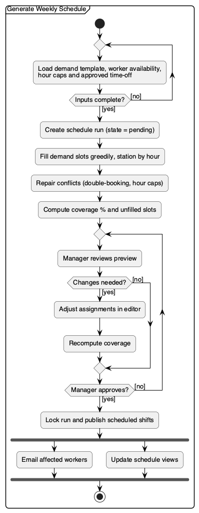

# Activity Diagram — Generate Weekly Schedule

How the manager builds, reviews and publishes a weekly schedule (UC-17, UC-18, UC-19).

## Notes

- Inputs are hashed into the schedule run, so re-running with the same inputs gives the same schedule (FEATURES 3.10, v1).
- The constraint-solver optimizer pass (FEATURES 3.6) is v1 and is not shown. The MVP generator is greedy fill plus conflict repair.
- After publishing, the schedule changes only through swap requests, open-shift claims, or a supervisor override that supersedes a slot.

_Source: [`src/activity-scheduling.puml`](./src/activity-scheduling.puml)_
