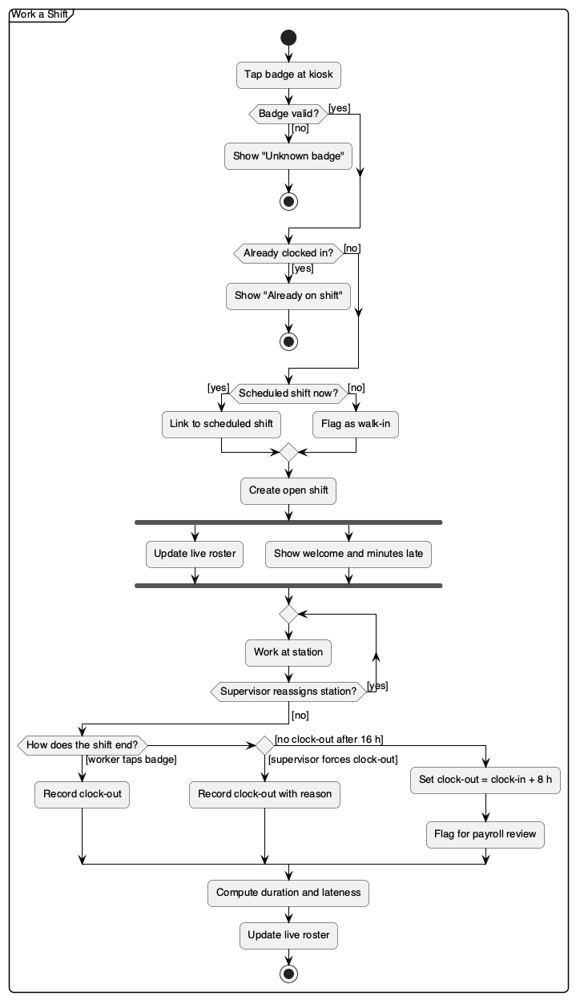

# Activity Diagram — Work a Shift

A worker's day on the floor, from badge tap to clock-out. Decisions carry `[guard]` labels on every exit. The fork/join bar shows the roster update and the kiosk greeting happening concurrently.

_Source: [`src/activity-shift.puml`](./src/activity-shift.puml)_
