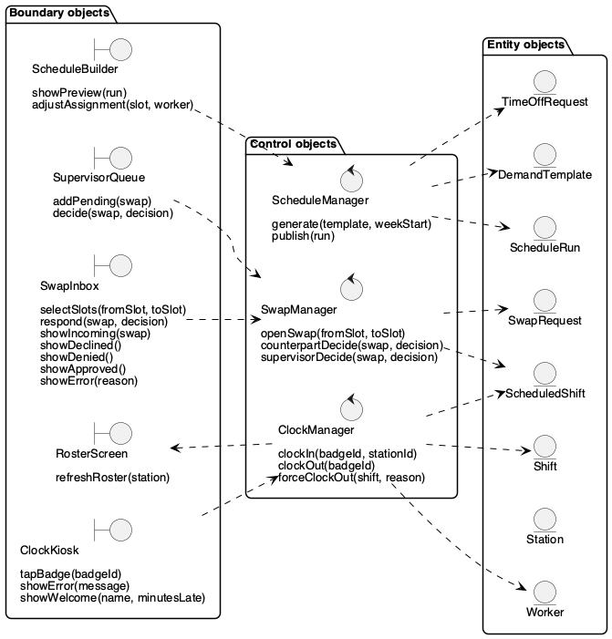

# Analysis Objects (Boundary / Control / Entity)

Initial analysis objects with their operations, drawn with the boundary, control and entity stereotype icons. Every message in the sequence diagrams is an operation listed here, or on the entity classes in the [class diagram](./class-diagram.md).

| Kind | Role | Objects |
|---|---|---|
| Boundary | Screens and devices the actors touch | ClockKiosk, RosterScreen, SwapInbox, SupervisorQueue, ScheduleBuilder |
| Control | Coordinates one use case | ClockManager, SwapManager, ScheduleManager |
| Entity | Persistent domain data | Worker, Station, Shift, ScheduledShift, SwapRequest, ScheduleRun, DemandTemplate, TimeOffRequest |

_Source: [`src/analysis-objects.puml`](./src/analysis-objects.puml)_
