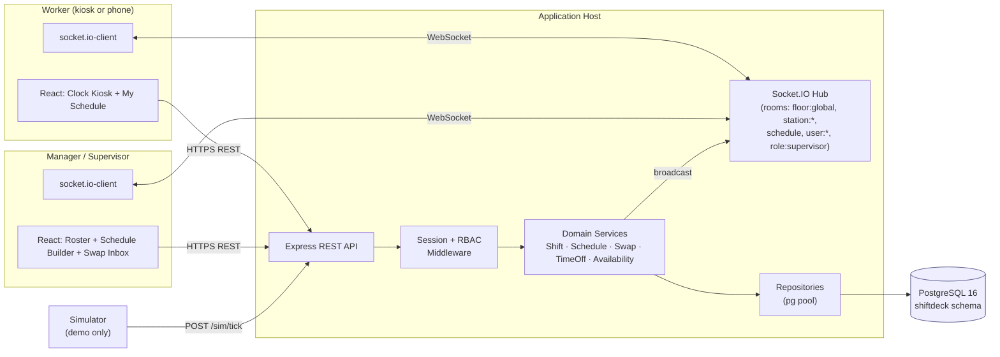

# System Architecture

Container-level view of ShiftDeck: processes, how they talk, and the trust boundary between the demo simulator and the operator-facing stack.

## Trust boundary

- **Browser side:** only REST + WebSocket, both over TLS in production. No direct DB access.
- **Simulator:** dev-only. The `/sim/*` routes are mounted only when `NODE_ENV=development`. There is no device-bridge equivalent in this scope — all realtime pressure comes from humans tapping badges.

## Scaling notes

- The `pg` pool is per-process; the hub currently runs single-node. Horizontal scale would add a Redis adapter for Socket.IO and move session storage out of memory into the same Redis.
- The hot path is clock-in and clock-out. Both are a single INSERT / UPDATE plus a broadcast — no telemetry fire-hose to shed.
