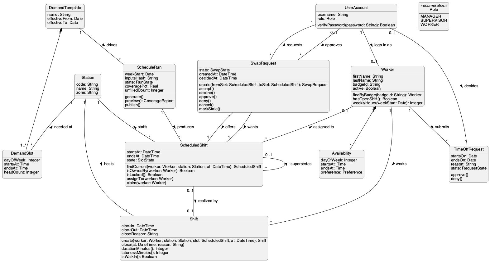

# Class Diagram (Conceptual Model)

Analysis-level domain model. Each class has three compartments (name, attributes, operations). Links between classes are shown as **labelled associations with multiplicity on both ends**, not as foreign-key attributes. The database realization of this model is in [`er-diagram.md`](./er-diagram.md) and [`schema.md`](./schema.md).

## Notes

- **Composition (filled diamond).** A `DemandSlot` cannot exist without its `DemandTemplate`, and an `Availability` window cannot exist without its `Worker`. Deleting the whole deletes the parts (`ON DELETE CASCADE` in the schema).
- **Planned vs. actual.** A `ScheduledShift` is what the manager published. A `Shift` is what happened on the floor. A shift realizes at most one scheduled shift; a walk-in shift realizes none.
- **Reflexive association.** A supervisor override creates a new `ScheduledShift` that *supersedes* the old one, keeping history intact.
- **Open shifts.** `Worker 0..1 — * ScheduledShift`: an open slot has no worker until someone claims it.
- `SwapRequest` has two associations to `ScheduledShift`: the slot the requester *offers* and the slot they *want*.
- The boundary and control objects used by the sequence diagrams are in [`analysis-objects.md`](./analysis-objects.md).

_Source: [`src/class-diagram.puml`](./src/class-diagram.puml)_
