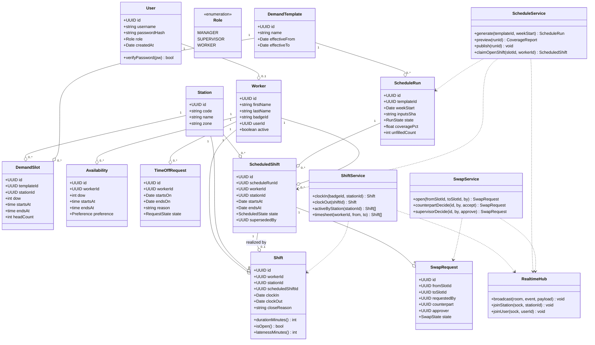

# Domain Class Diagram

Backend domain model. Services expose use-case methods and lean on repositories for persistence; entities are plain data classes mapped to Postgres rows.

## Notes

- `Shift.scheduledShiftId` is nullable — walk-in / unscheduled clock-ins are allowed but flagged.
- Services are the only writers. Routes call services; services call repositories.
- `RealtimeHub` is injected into services so broadcasts and persistence stay in one transaction boundary.
