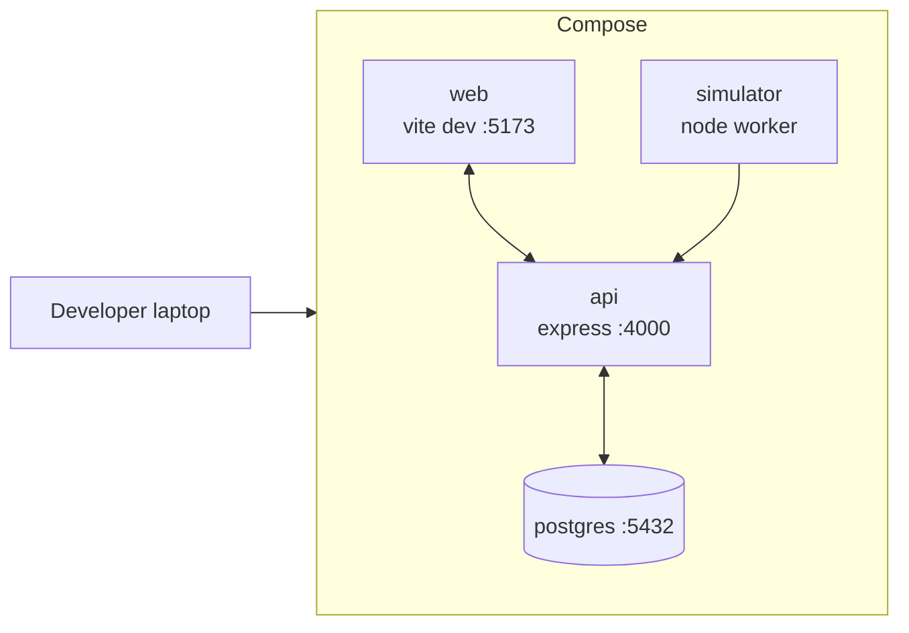
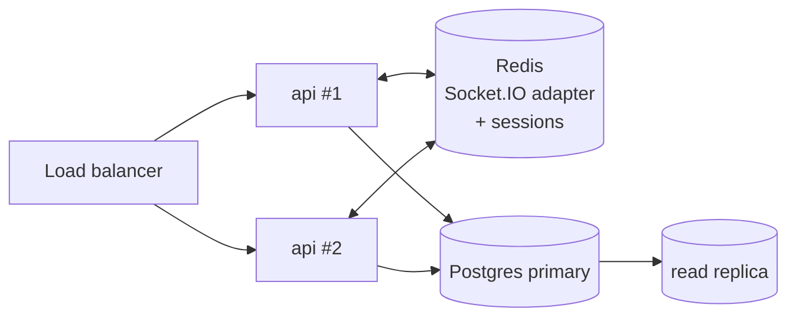

# Deployment Topology

Dev target is `docker compose up`. Production target is a single VM behind an Nginx reverse proxy, with a managed Postgres instance.

## Development



- `vite` runs with HMR; proxies `/api` + `/socket.io` to `api`.
- `simulator` boots last; waits on `api` healthcheck. It is dev-only — it posts fake clock-in / clock-out events against `/sim/tick`.
- `postgres` volume is `./.data/pg`.

## Production

```mermaid
flowchart LR
    Users[Workers (kiosks + phones)<br/>+ Managers] -- HTTPS/443 --> Edge[Nginx TLS]
    Edge -- "/" --> Static[Static web bundle<br/>served by Nginx]
    Edge -- "/api, /socket.io" --> API[Express + Socket.IO<br/>systemd unit]
    API -- SQL --> PG[(Managed PostgreSQL)]
    API --> Logs[(Journald → Loki)]
```

### Boundary notes

- **Nginx** terminates TLS and is the only process listening on `:443`. `api` listens on loopback only.
- **No simulator in prod.** `/sim/*` routes are mounted only when `NODE_ENV=development`.
- **Postgres** is unreachable from the public internet; connection string is pulled from the host's secrets store at service start.
- **Observability.** `api` ships structured Pino logs to journald → Loki.

## Scale-out (future)



The only hard dependency added is Redis — Socket.IO uses its pub/sub to fan broadcasts across instances, and sessions move out of in-memory maps.
