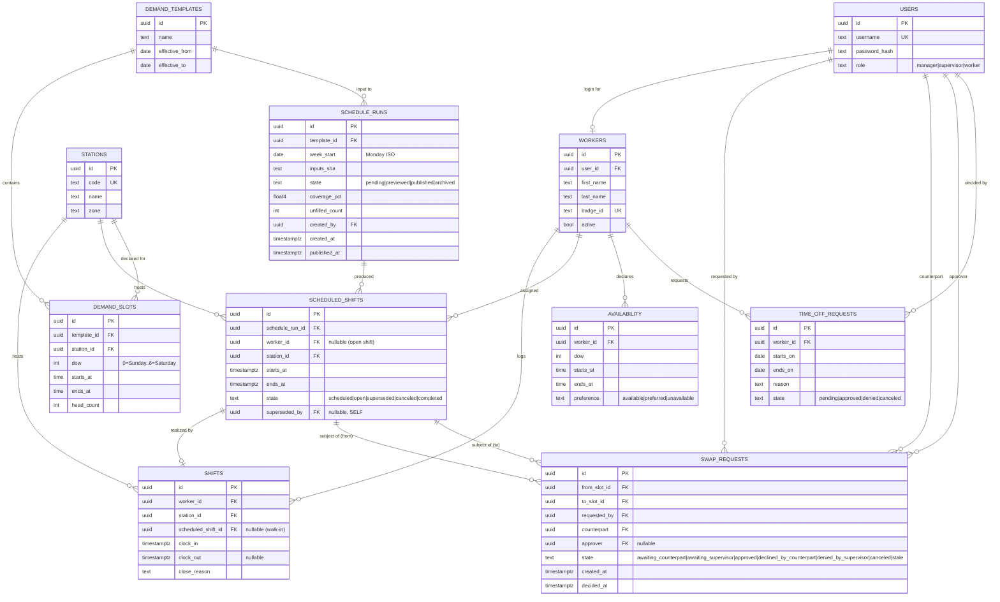

# Entity-Relationship Diagram

Postgres schema `shiftdeck`. UUID primary keys, `created_at` / `updated_at` on every table (omitted here for clarity).

## Indexing & retention

- `shifts` — partial unique index `(worker_id) WHERE clock_out IS NULL` blocks double clock-ins; btree `(worker_id, clock_in DESC)` for the timesheet query.
- `scheduled_shifts` — unique index `(worker_id, starts_at) WHERE state IN ('scheduled','open') AND worker_id IS NOT NULL` to block double-booking; btree `(schedule_run_id, state)` for publish queries; partial index `WHERE worker_id IS NULL AND state='open'` for the open-shift marketplace.
- `swap_requests` — partial index `WHERE state IN ('awaiting_counterpart','awaiting_supervisor')` for inbox queries.
- `shifts` are permanent (payroll). `scheduled_shifts` is permanent (history + audit of what was planned vs. what happened).
