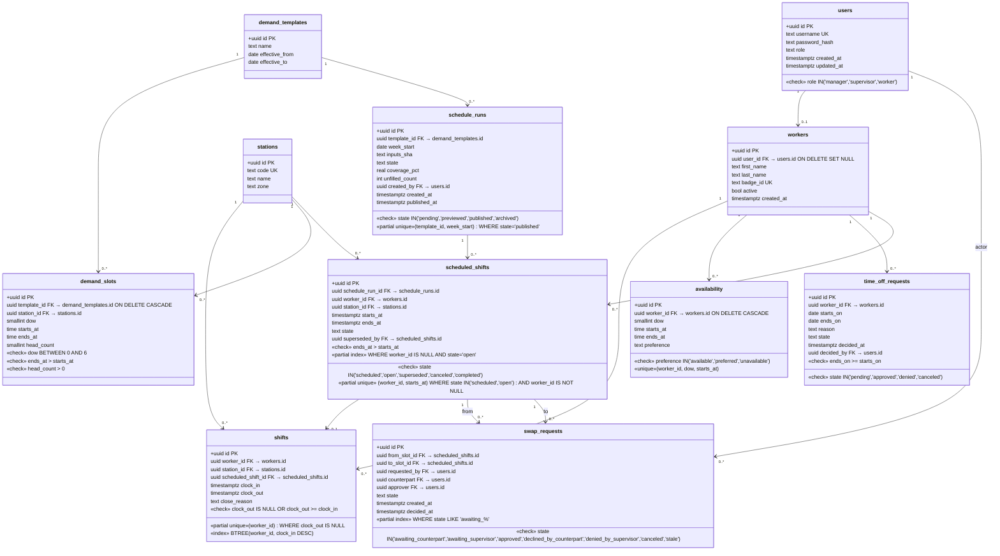

# Database Schema

Companion to the [ER diagram](./er-diagram.md). The ER view shows cardinalities; this view shows every column, every constraint, and every index you would see with `\d+` in `psql`.



## Migration order

```
001_init_users.sql
002_workers_stations.sql
003_demand_templates_slots.sql
004_availability_timeoff.sql
005_schedule_runs_shifts.sql
006_shifts_clockevents.sql
007_swap_requests.sql
```

Each file is additive and reversible. `node-pg-migrate` tracks applied names in `pgmigrations`.
