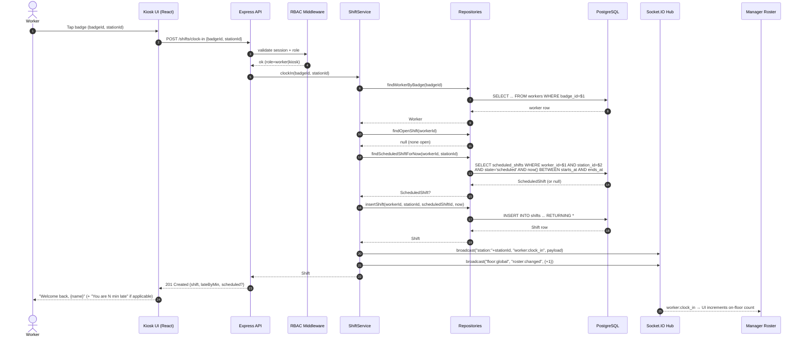

# Sequence — Worker Clock-In

Flow starts when a worker taps their badge at the kiosk. Ends when every manager with the roster open sees the new on-floor count tick up without a page refresh.

## Error branches

- **Already clocked in** — `findOpenShift` returns a shift; service throws `ConflictError`; API responds `409`.
- **Unknown badge** — repo returns null; service throws `NotFoundError`; API responds `404`.
- **No scheduled shift at this time** — `scheduledShiftId` is left null and the shift is flagged `walk_in` so attendance reports can show it.
