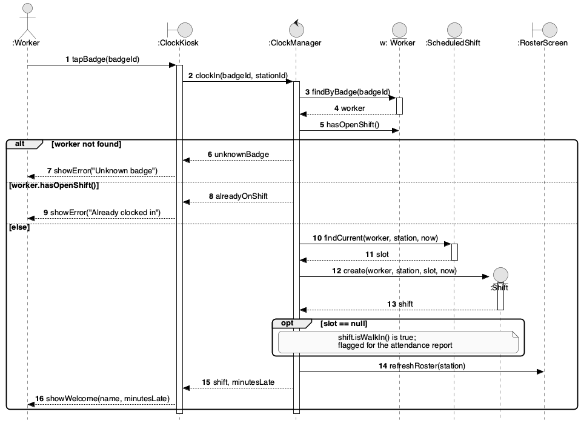

# Sequence Diagram — Clock In (UC-02)

Enacts the **Clock In** use case. Lifelines are the actor, the boundary object (kiosk), the control object, and the entity objects it uses. Messages are numbered. Error branches are `alt` fragments with guards.

## Branches

| Guard | Outcome |
|---|---|
| `[worker not found]` | Kiosk shows "Unknown badge". No shift is created. |
| `[worker.hasOpenShift()]` | Kiosk shows "Already clocked in". No shift is created. |
| `[else]` | A new `Shift` is created and the roster is refreshed. |
| `opt [slot == null]` | No scheduled shift matches now: the shift is a walk-in (UC-05) and appears on the attendance report. |

_Source: [`src/seq-clock-in.puml`](./src/seq-clock-in.puml)_
