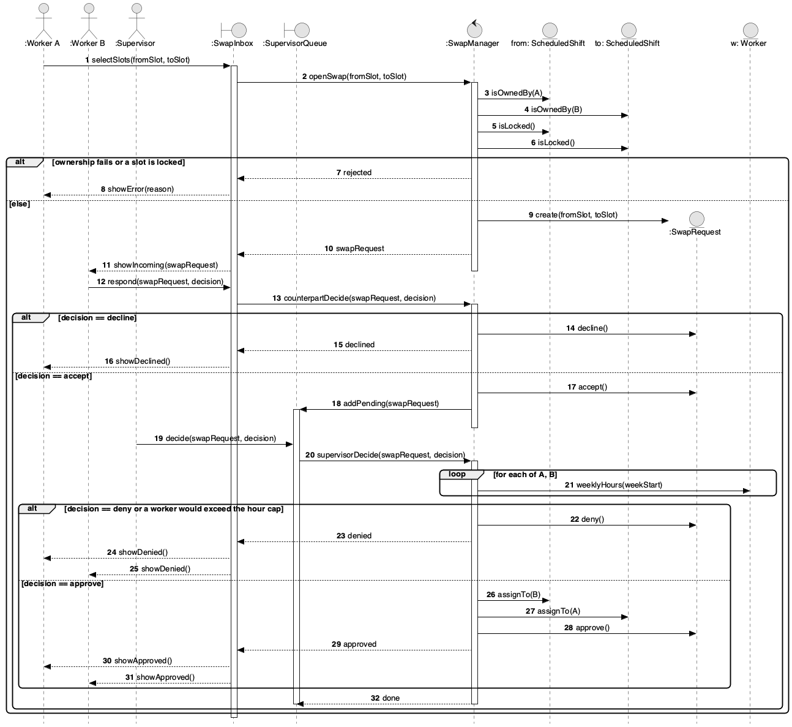

# Sequence Diagram — Shift Swap (UC-08, UC-09, UC-10)

Worker A offers their slot for Worker B's slot. B must accept, then a supervisor must approve. The slots are reassigned only on approval.

## Branches

| Guard | Outcome |
|---|---|
| `[ownership fails or a slot is locked]` | Request rejected. Nothing is created. |
| `[decision == decline]` | `SwapRequest.decline()`. A is notified. No slot changes. |
| `[decision == deny or a worker would exceed the hour cap]` | `SwapRequest.deny()`. Both workers are notified. No slot changes. |
| `[decision == approve]` | Both slots are reassigned, then `SwapRequest.approve()`. Both workers are notified. |

If the schedule changes while the request is pending, the request becomes **Stale** (see the [state diagram](./state-swap-request.md)) and must be re-opened.

_Source: [`src/seq-swap-request.puml`](./src/seq-swap-request.puml)_
