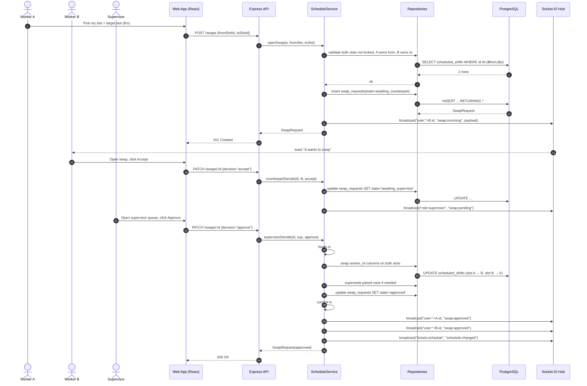

# Sequence — Shift Swap Request

Worker A asks to trade their Thursday 2–10 PM slot for Worker B's Friday 6 AM–2 PM slot. B must accept; a supervisor must approve the final trade.

## Rejection branches

- **B declines** → `state=declined_by_counterpart`; A notified; no slot changes.
- **Supervisor denies** → `state=denied_by_supervisor`; both notified; no slot changes.
- **Slot locked** between request and approval → `state=stale`; request must be re-opened on the new slot.
