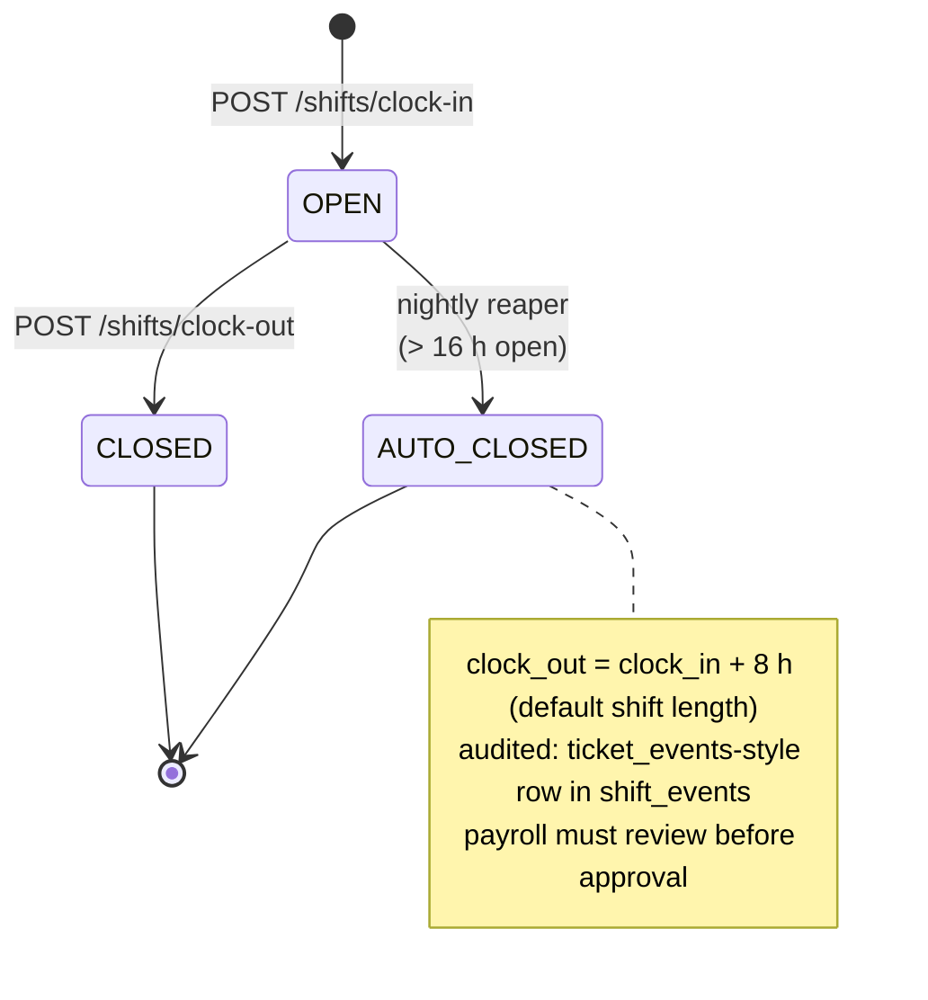

# State Machine — Shift

A `shifts` row is created `OPEN` on clock-in. The only legal terminal state is `CLOSED`. Rows older than 16 h with no clock-out are closed by a nightly reaper and tagged `auto_closed` in the audit event stream so payroll can review them.

## Invariants

- At most one `OPEN` shift per `worker_id` at any time. Enforced by a partial unique index: `CREATE UNIQUE INDEX one_open_shift ON shifts (worker_id) WHERE clock_out IS NULL;`
- `clock_out ≥ clock_in` enforced by a `CHECK` constraint.
- Reassigning a worker to another station mid-shift is modeled as `CLOSED` on station A + fresh `OPEN` on station B, not a mutation of the open row.
