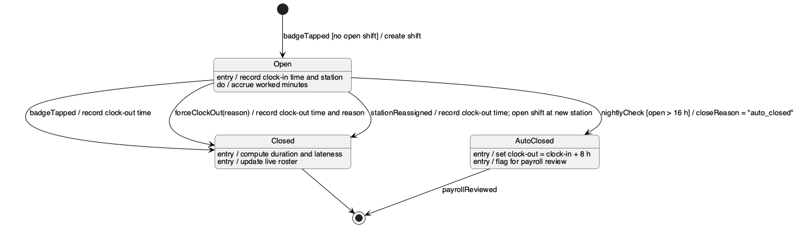

# State Machine Diagram — Shift

States of one `Shift` from clock-in to clock-out. Transitions are labelled `event [guard] / action`. States list their `entry`, `do` and `exit` behaviour.

## Invariants

- At most one **Open** shift per worker at any time.
- Clock-out time is never earlier than clock-in time.
- Moving a worker to another station closes the current shift and opens a new one at the new station. The open shift is never edited in place.
- **AutoClosed** is recorded as `closeReason = "auto_closed"`. The schema has no separate state column: an open shift is one whose clock-out is empty.

_Source: [`src/state-shift.puml`](./src/state-shift.puml)_
