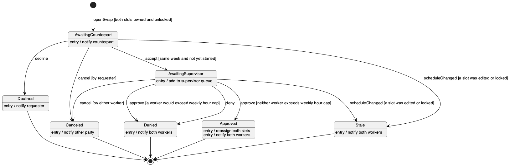

# State Machine Diagram — Swap Request

Lifecycle of one `SwapRequest`. Approval needs two consents: the counterpart worker, then a supervisor. Transitions are labelled `event [guard] / action`.

## Guards

| Transition | Guard |
|---|---|
| start → AwaitingCounterpart | Requester owns the offered slot, counterpart owns the wanted slot, and neither slot is locked. |
| AwaitingCounterpart → AwaitingSupervisor | Both slots are in the same week and neither has started. |
| AwaitingSupervisor → Approved | Neither worker would exceed their weekly hour cap after the swap. |
| any open state → Stale | One of the slots was edited or locked by a schedule change (its `scheduleRun` changed) after the request was opened. |

_Source: [`src/state-swap-request.puml`](./src/state-swap-request.puml)_
