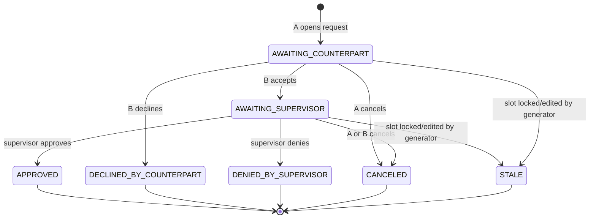

# State Machine — Shift Swap Request

Every `swap_requests` row moves through this lifecycle. Approvals need two consents: the counterpart worker, then a supervisor.

## Guards

| Transition | Guard |
|---|---|
| any → `AWAITING_SUPERVISOR` | both slots still exist, same week, not yet started |
| `AWAITING_SUPERVISOR → APPROVED` | neither worker now exceeds weekly hour cap after swap |
| any → `STALE` | at least one slot's `generation_run_id` changed since request opened |

## Side effects

- `APPROVED` writes the swap in a single transaction and broadcasts `swap:approved` on the two worker rooms and `schedule:changed` on the global schedule room.
- Any terminal state writes a `ticket_events`-style row in `swap_events` for audit.
