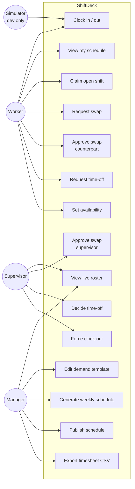

# Use Cases

Three human actors (plus a simulator for demos). Mermaid has no dedicated use-case shape; the diagram is drawn with a flowchart grouped by the system boundary.

## Primary flows

- **Clock-in (Worker).** Worker taps their badge; API opens a `shifts` row, matches it to the next `scheduled_shifts` row for that worker/station, hub broadcasts the roster change.
- **Clock-out (Worker).** Taps again; API closes the row with duration + late/early flags.
- **Swap (Worker → Worker → Supervisor).** A opens a request against B's slot. B accepts. Supervisor approves. Slots are atomically re-assigned.
- **Schedule build (Manager).** Build or edit demand template → kick off a run → review coverage → publish. Workers are notified of their new schedule.
- **Timesheet export (Manager).** Pick date range + worker set → download CSV for payroll.
