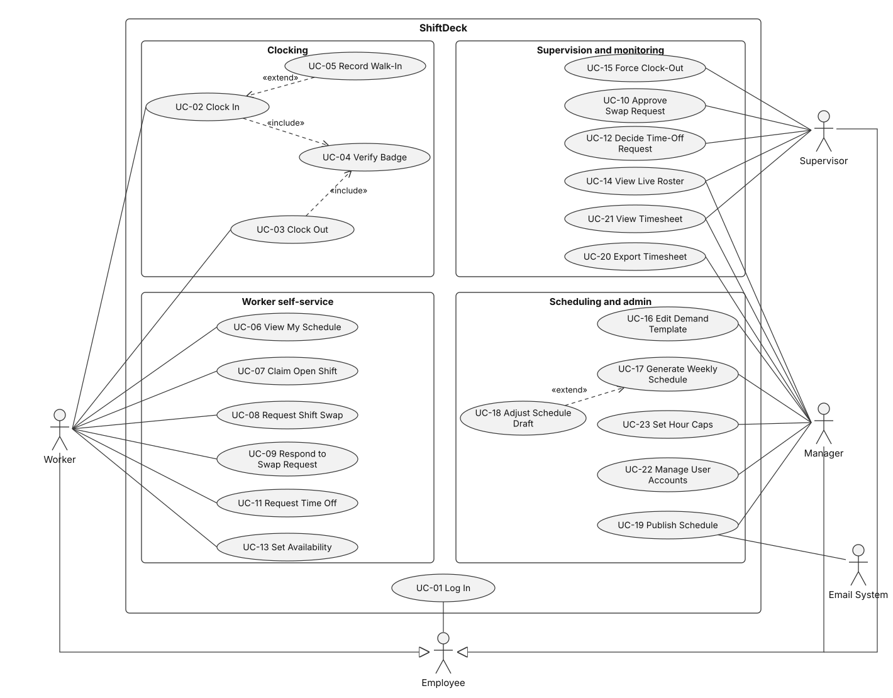

# Use Case Model

Three human actors share an abstract **Employee** actor, which owns **UC-01 Log In**. The **Email System** is a secondary actor that receives schedule notifications. The use case IDs (UC-01 … UC-23) are stable, so requirements, code and test cases can trace to them. The four labelled boxes inside the system boundary only group related use cases for readability; they carry no UML meaning.

## Use case index

| ID | Use case | Primary actor | FEATURES # |
|---|---|---|---|
| UC-01 | Log In | Employee | 5.1, 5.2 |
| UC-02 | Clock In | Worker | 1.1, 1.3, 1.5 |
| UC-03 | Clock Out | Worker | 1.2 |
| UC-04 | Verify Badge | (included) | 1.1 |
| UC-05 | Record Walk-In | (extends UC-02) | 1.5 |
| UC-06 | View My Schedule | Worker | 2.1 |
| UC-07 | Claim Open Shift | Worker | 2.2 |
| UC-08 | Request Shift Swap | Worker | 2.3 |
| UC-09 | Respond to Swap Request | Worker | 2.3 |
| UC-10 | Approve Swap Request | Supervisor | 2.3 |
| UC-11 | Request Time Off | Worker | 2.5 |
| UC-12 | Decide Time-Off Request | Supervisor | 2.5 |
| UC-13 | Set Availability | Worker | 2.6, 3.2 |
| UC-14 | View Live Roster | Supervisor, Manager | 4.1, 4.2 |
| UC-15 | Force Clock-Out | Supervisor | 1.4 |
| UC-16 | Edit Demand Template | Manager | 3.1 |
| UC-17 | Generate Weekly Schedule | Manager | 3.3 |
| UC-18 | Adjust Schedule Draft | (extends UC-17) | 3.5 |
| UC-19 | Publish Schedule | Manager | 3.4 |
| UC-20 | Export Timesheet | Manager | 4.4 |
| UC-21 | View Timesheet | Supervisor, Manager | 4.3 |
| UC-22 | Manage User Accounts | Manager | 5.3 |
| UC-23 | Set Hour Caps | Manager | 3.2 |

## Associations

| Relationship | Meaning |
|---|---|
| UC-02 Clock In `<<include>>` UC-04 Verify Badge | Every clock-in validates the badge first. |
| UC-03 Clock Out `<<include>>` UC-04 Verify Badge | Every clock-out validates the badge first. |
| UC-05 Record Walk-In `<<extend>>` UC-02 Clock In | Exceptional case: no scheduled shift matches the clock-in. |
| UC-18 Adjust Schedule Draft `<<extend>>` UC-17 Generate Weekly Schedule | Optional: the manager hand-edits the generated draft before publishing. |
| Worker, Supervisor, Manager → Employee | Actor generalization: all three can log in. |

## Primary flows

- **Badge tap (Worker).** One tap at a kiosk. If the worker has no open shift, the system clocks them in: it opens a shift, links it to the matching scheduled shift (or records a walk-in), and updates the live roster. If the worker already has an open shift, the same tap clocks them out: the system closes the shift, computes duration and lateness, and updates the roster (FR-2.1.2).
- **Swap (Worker A → Worker B → Supervisor).** A requests B's slot, B accepts, and a supervisor approves. Both slots are reassigned together.
- **Schedule build (Manager).** Edit the demand template, generate a run, review coverage, adjust if needed, then publish. Affected workers are emailed.
- **Timesheet export (Manager).** Pick a date range and set of workers, then download a CSV for payroll.

The demo simulator is not an actor. It is a development tool, not an external user of the system.

## Use case descriptions

### UC-01 Log In

| Field | Content |
|---|---|
| Actor | Employee (Worker, Supervisor, Manager) |
| Description | An employee enters a username and password to start a session and reach the home screen for their role. |
| Preconditions | The employee has an active account. |
| Postconditions | A session is started and the home screen for the employee's role is displayed. |
| Priority | High |
| Frequency of Use | Once per employee per working day. |
| Flow of Events | 1. The Employee opens ShiftDeck in a browser. 2. The system displays the Log In screen. 3. The Employee enters a username and password and selects Log In. 4. The system checks the username and password against the active accounts. 5. The system starts a session and displays the home screen for the account's role. |
| Alternative Flows | At any time after step 5, the Employee selects Log Out. The system ends the session and displays the Log In screen. |
| Exceptions | If the username or password does not match an active account, the system displays "Invalid username or password" and does not start a session. If the account is disabled, the system displays "Invalid username or password" and does not start a session. |
| Includes | None. |
| Special Requirements | Passwords are stored only as salted one-way hashes. A session expires after 30 minutes of inactivity. |
| Assumptions | Each account has exactly one role. |
| Notes and Issues | Password reset by the Manager is handled in Manage User Accounts. |

### UC-02 Clock In

| Field | Content |
|---|---|
| Actor | Worker |
| Description | A worker taps their badge at a station kiosk to start a shift. |
| Preconditions | The kiosk is installed at a station and shows the badge prompt and the worker has no open shift. |
| Postconditions | An open shift is recorded for the worker at the station and the worker appears on the live roster. |
| Priority | High |
| Frequency of Use | Once per worker per shift. |
| Flow of Events | 1. The Worker taps their badge on the kiosk badge reader. 2. The system verifies the badge (Verify Badge). 3. The system checks that the worker has no open shift; otherwise the Clock Out use case is performed. 4. The system finds the worker's scheduled shift at this station whose time window contains the current time and computes the minutes late. 5. The system records an open shift with the worker, the station and the clock-in time, linked to the scheduled shift. 6. The system adds the worker to the live roster. 7. The kiosk displays "Welcome, &lt;first name>" and, if late, the number of minutes late. |
| Alternative Flows | At step 4, if no scheduled shift matches, the Record Walk-In use case is performed. |
| Exceptions | None. (Unknown badge is already handled by Verify Badge.) |
| Includes | Verify Badge. Extended by Record Walk-In. |
| Special Requirements | The confirmation is displayed within 2 seconds of the badge tap. Clock-in needs one badge tap and no keyboard input. |
| Assumptions | Each worker has exactly one badge. Each kiosk knows its station ID. |
| Notes and Issues | None. |

### UC-03 Clock Out

| Field | Content |
|---|---|
| Actor | Worker |
| Description | A worker taps their badge at a kiosk to end their open shift. |
| Preconditions | The kiosk shows the badge prompt and the worker has an open shift. |
| Postconditions | The worker's open shift is closed with a clock-out time and the worker is removed from the live roster. |
| Priority | High |
| Frequency of Use | Once per worker per shift. |
| Flow of Events | 1. The Worker taps their badge on the kiosk badge reader. 2. The system verifies the badge (Verify Badge). 3. The system finds the worker's open shift. 4. The system records the clock-out time and computes the shift duration. 5. The system removes the worker from the live roster. 6. If the shift is linked to a scheduled shift, the system compares the times and flags the shift as late, early or on time. 7. The kiosk displays "Goodbye, &lt;first name>" and "Shift length: &lt;h> h &lt;m> min". |
| Alternative Flows | None. |
| Exceptions | None. |
| Includes | Verify Badge. |
| Special Requirements | The confirmation is displayed within 2 seconds of the badge tap. |
| Assumptions | A worker can clock out at any kiosk. |
| Notes and Issues | None. |

### UC-04 Verify Badge

| Field | Content |
|---|---|
| Actor | Worker (through Clock In and Clock Out) |
| Description | The system confirms that a tapped badge belongs to an active worker. |
| Preconditions | A badge ID has been read by the kiosk badge reader. |
| Postconditions | The worker who owns the badge is identified, or the badge is rejected. |
| Priority | High |
| Frequency of Use | Every clock-in and clock-out. |
| Flow of Events | 1. The kiosk sends the badge ID and station ID to the system. 2. The system looks up the active worker with that badge ID. 3. The system returns the worker to the calling use case. |
| Alternative Flows | None. |
| Exceptions | If no active worker has the badge ID, the kiosk displays "Unknown badge" and the calling use case ends without recording anything. |
| Includes | Included by Clock In and Clock Out. |
| Special Requirements | None. |
| Assumptions | The badge reader delivers the badge ID to the browser as keyboard input, followed by Enter. |
| Notes and Issues | Any keyboard-emulation badge reader is supported (see IR-2.1). |

### UC-05 Record Walk-In

| Field | Content |
|---|---|
| Actor | Worker |
| Description | Clock-in for a worker who has no scheduled shift at this station for the current time. |
| Preconditions | The worker's badge is verified, the worker has no open shift, and no scheduled shift matches the clock-in. |
| Postconditions | An open shift is recorded and marked as a walk-in. |
| Priority | High |
| Frequency of Use | Occasional; when a worker comes in unscheduled. |
| Flow of Events | 1. The system records an open shift with the worker, the station and the clock-in time, with no linked scheduled shift. 2. The system marks the shift as a walk-in. 3. The system adds the worker to the live roster. 4. The kiosk displays "Welcome, &lt;first name>". |
| Alternative Flows | None. |
| Exceptions | None. |
| Includes | Extends Clock In. |
| Special Requirements | None. |
| Assumptions | Walk-ins are allowed; a supervisor reviews them in the attendance report. |
| Notes and Issues | Should a walk-in need supervisor approval before it counts for payroll? |

### UC-06 View My Schedule

| Field | Content |
|---|---|
| Actor | Worker |
| Description | A worker views their own scheduled shifts for the next 14 days. |
| Preconditions | The Worker is logged in. |
| Postconditions | The worker's upcoming shifts are displayed. |
| Priority | High |
| Frequency of Use | Several times per worker per week. |
| Flow of Events | 1. The Worker selects My Schedule. 2. The system retrieves the worker's scheduled shifts for the next 14 days. 3. The system displays the date, start time, end time and station of each shift. |
| Alternative Flows | At step 3, the Worker selects a shift and chooses Request Swap; the Request Shift Swap use case is performed. At step 3, the Worker selects Download; the system provides the shifts as an ICS calendar file. |
| Exceptions | If the worker has no scheduled shifts, the system displays "No upcoming shifts". |
| Includes | None. |
| Special Requirements | Usable on a 360-pixel-wide screen without horizontal scrolling. |
| Assumptions | None. |
| Notes and Issues | None. |

### UC-07 Claim Open Shift

| Field | Content |
|---|---|
| Actor | Worker |
| Description | A worker takes an unassigned shift from the open shift list. |
| Preconditions | The Worker is logged in and at least one open shift exists. |
| Postconditions | The shift is assigned to the worker and removed from the open shift list. |
| Priority | High |
| Frequency of Use | A few times per worker per week. |
| Flow of Events | 1. The Worker selects Open Shifts. 2. The system displays the date, start time, end time and station of each open shift. 3. The Worker selects a shift and chooses Claim. 4. The system checks that the shift does not overlap another of the worker's shifts and does not put the worker over their weekly hour cap. 5. The system assigns the shift to the worker and removes it from the open list. 6. The system displays a confirmation. |
| Alternative Flows | None. |
| Exceptions | If the shift overlaps another of the worker's shifts, the system rejects the claim and displays the conflicting shift. If the claim would exceed the worker's weekly hour cap, the system rejects the claim and displays the cap. |
| Includes | None. |
| Special Requirements | 80% of first-time workers can claim an open shift within 2 minutes without help. |
| Assumptions | Open shifts are claimed first come, first served. |
| Notes and Issues | None. |

### UC-08 Request Shift Swap

| Field | Content |
|---|---|
| Actor | Worker (requester) |
| Description | A worker offers one of their scheduled shifts in exchange for a coworker's scheduled shift. |
| Preconditions | The Worker is logged in and holds at least one scheduled shift that has not started. |
| Postconditions | A pending swap request exists and the counterpart is notified. |
| Priority | High |
| Frequency of Use | A few times per week across the team. |
| Flow of Events | 1. The Worker selects one of their shifts and chooses Request Swap. 2. The system displays coworkers' shifts that can be requested. 3. The Worker selects the wanted shift and submits the request. 4. The system checks that each worker holds the shift involved and that neither shift has started or belongs to a locked schedule run. 5. The system records the swap request as pending. 6. The system notifies the counterpart. |
| Alternative Flows | Before approval, the Worker opens the Swap Inbox and cancels the request. The system marks it canceled and notifies the counterpart. If either shift is changed by the schedule while the request is open, the system marks the request stale and notifies both workers. |
| Exceptions | If a check in step 4 fails, the system rejects the request and displays the reason. |
| Includes | None. |
| Special Requirements | Both shifts are reassigned together or not at all. |
| Assumptions | None. |
| Notes and Issues | None. |

### UC-09 Respond to Swap Request

| Field | Content |
|---|---|
| Actor | Worker (counterpart) |
| Description | The coworker who received a swap request accepts or declines it. |
| Preconditions | A pending swap request is addressed to the Worker. |
| Postconditions | The request is either declined or waiting for supervisor approval. |
| Priority | High |
| Frequency of Use | A few times per week across the team. |
| Flow of Events | 1. The Worker opens the Swap Inbox. 2. The system displays the incoming request with both shifts. 3. The Worker selects Accept. 4. The system adds the request to the supervisor approval queue. 5. The system notifies the requester that the request was accepted. |
| Alternative Flows | At step 3, the Worker selects Decline. The system marks the request declined, notifies the requester and leaves both shifts unchanged. After accepting and before approval, the Worker cancels. The system marks the request canceled and notifies the requester. |
| Exceptions | None. |
| Includes | None. |
| Special Requirements | None. |
| Assumptions | None. |
| Notes and Issues | None. |

### UC-10 Approve Swap Request

| Field | Content |
|---|---|
| Actor | Supervisor |
| Description | A supervisor approves or denies a swap request that the counterpart accepted. |
| Preconditions | The Supervisor is logged in and an accepted swap request is in the approval queue. |
| Postconditions | Both shifts are reassigned, or the request is denied and both shifts are unchanged. |
| Priority | High |
| Frequency of Use | A few times per week. |
| Flow of Events | 1. The Supervisor opens the Supervisor Queue. 2. The system displays the accepted swap requests. 3. The Supervisor selects a request and chooses Approve. 4. The system checks that neither worker would exceed their weekly hour cap after the swap. 5. The system reassigns both shifts in a single operation. 6. The system notifies both workers. |
| Alternative Flows | At step 3, the Supervisor chooses Deny. The system marks the request denied, notifies both workers and leaves both shifts unchanged. |
| Exceptions | If either worker would exceed their weekly hour cap, the system denies the request and notifies both workers. |
| Includes | None. |
| Special Requirements | Both shifts are reassigned or neither is. |
| Assumptions | None. |
| Notes and Issues | None. |

### UC-11 Request Time Off

| Field | Content |
|---|---|
| Actor | Worker |
| Description | A worker asks to be left off the schedule for a date range. |
| Preconditions | The Worker is logged in. |
| Postconditions | A pending time-off request is visible to supervisors. |
| Priority | Medium |
| Frequency of Use | A few times per worker per year. |
| Flow of Events | 1. The Worker selects Time Off. 2. The system displays the request form and the worker's existing requests. 3. The Worker enters a start date, an end date and a reason, and submits. 4. The system checks that the end date is not before the start date. 5. The system records the request as pending and displays it in the list. |
| Alternative Flows | None. |
| Exceptions | If the end date is before the start date, the system rejects the request and displays the error. |
| Includes | None. |
| Special Requirements | None. |
| Assumptions | None. |
| Notes and Issues | Can a worker cancel a pending time-off request? |

### UC-12 Decide Time-Off Request

| Field | Content |
|---|---|
| Actor | Supervisor |
| Description | A supervisor approves or denies a pending time-off request. |
| Preconditions | The Supervisor is logged in and a pending time-off request exists. |
| Postconditions | The request is approved or denied and the worker is notified. |
| Priority | Medium |
| Frequency of Use | A few times per week. |
| Flow of Events | 1. The Supervisor opens the Supervisor Queue. 2. The system displays the pending time-off requests. 3. The Supervisor selects a request and chooses Approve or Deny. 4. The system updates the request state. 5. The system notifies the worker. |
| Alternative Flows | None. |
| Exceptions | None. |
| Includes | None. |
| Special Requirements | None. |
| Assumptions | Approved time off is respected by the schedule generator. |
| Notes and Issues | None. |

### UC-13 Set Availability

| Field | Content |
|---|---|
| Actor | Worker |
| Description | A worker declares when they can and prefer to work each day of the week. |
| Preconditions | The Worker is logged in. |
| Postconditions | The worker's availability windows are saved. |
| Priority | High |
| Frequency of Use | When a worker joins and when their availability changes. |
| Flow of Events | 1. The Worker selects Availability. 2. The system displays the worker's current availability windows. 3. The Worker adds or edits a window: day of week, start time, end time and preference (available, preferred or unavailable). 4. The Worker selects Save. 5. The system saves the windows and displays them. |
| Alternative Flows | At step 3, the Worker deletes a window. |
| Exceptions | If the end time is not after the start time, the system rejects the window and displays the error. |
| Includes | None. |
| Special Requirements | None. |
| Assumptions | None. |
| Notes and Issues | None. |

### UC-14 View Live Roster

| Field | Content |
|---|---|
| Actor | Supervisor, Manager |
| Description | A supervisor or manager watches who is currently clocked in. |
| Preconditions | The Supervisor or Manager is logged in. |
| Postconditions | The current roster and daily counts are displayed. |
| Priority | High |
| Frequency of Use | Continuously during operating hours. |
| Flow of Events | 1. The Supervisor or Manager selects Live Roster. 2. The system displays each worker currently clocked in, their station and the time elapsed since clock-in. 3. The system displays the number of workers on the floor, the number of open shifts and the number of missed clock-ins for the day. 4. When a worker clocks in or out, the system updates the roster without a page reload. |
| Alternative Flows | At step 2, a Supervisor selects a worker and chooses Force Clock-Out; the Force Clock-Out use case is performed. |
| Exceptions | None. |
| Includes | None. |
| Special Requirements | A clock event appears on every open roster screen within 2 seconds. |
| Assumptions | None. |
| Notes and Issues | None. |

### UC-15 Force Clock-Out

| Field | Content |
|---|---|
| Actor | Supervisor |
| Description | A supervisor closes a worker's open shift, for example when the worker forgot to clock out. |
| Preconditions | The Supervisor is logged in and the worker has an open shift. |
| Postconditions | The shift is closed with the current time and the reason. |
| Priority | High |
| Frequency of Use | A few times per week. |
| Flow of Events | 1. The Supervisor selects a worker on the Live Roster and chooses Force Clock-Out. 2. The system asks for a reason. 3. The Supervisor enters a reason and confirms. 4. The system closes the shift with the current time and the reason. 5. The system removes the worker from the live roster. |
| Alternative Flows | At step 3, the Supervisor cancels; nothing changes. |
| Exceptions | None. |
| Includes | None. |
| Special Requirements | None. |
| Assumptions | None. |
| Notes and Issues | None. |

### UC-16 Edit Demand Template

| Field | Content |
|---|---|
| Actor | Manager |
| Description | A manager states how many workers each station needs for each day of the week and time window. |
| Preconditions | The Manager is logged in. |
| Postconditions | The demand template is saved. |
| Priority | High |
| Frequency of Use | When staffing needs change. |
| Flow of Events | 1. The Manager opens Schedule Builder and selects a demand template or New Template. 2. The Manager enters the template name and effective dates. 3. The Manager adds or edits demand slots: station, day of week, start time, end time and head-count. 4. The Manager selects Save. 5. The system checks each slot and saves the template. |
| Alternative Flows | At step 3, the Manager deletes a demand slot. |
| Exceptions | If a slot's end time is not after its start time, or its head-count is less than 1, the system rejects the slot and displays the error. |
| Includes | None. |
| Special Requirements | None. |
| Assumptions | None. |
| Notes and Issues | None. |

### UC-17 Generate Weekly Schedule

| Field | Content |
|---|---|
| Actor | Manager |
| Description | A manager generates a draft schedule for a week from a demand template. |
| Preconditions | The Manager is logged in and a demand template exists. |
| Postconditions | A draft schedule with coverage and unfilled slots is displayed. |
| Priority | High |
| Frequency of Use | Once per week. |
| Flow of Events | 1. The Manager opens Schedule Builder and selects Generate. 2. The Manager selects a demand template and a week start date. 3. The system checks that every worker has availability and an hour cap. 4. The system assigns workers to demand slots, skipping approved time-off, unavailable windows, overlapping shifts and shifts beyond the hour cap. 5. The system displays the draft with its coverage percentage and the list of unfilled slots. |
| Alternative Flows | At step 5, the Manager edits the draft; the Adjust Schedule Draft use case is performed. At step 5, the Manager selects Publish; the Publish Schedule use case is performed. |
| Exceptions | If a worker has no availability or no hour cap, the system lists the missing inputs and does not generate the draft. |
| Includes | Extended by Adjust Schedule Draft. |
| Special Requirements | Generation for 50 workers and one week finishes within 10 seconds. |
| Assumptions | None. |
| Notes and Issues | None. |

### UC-18 Adjust Schedule Draft

| Field | Content |
|---|---|
| Actor | Manager |
| Description | A manager changes the generated draft by hand before publishing. |
| Preconditions | A draft schedule is displayed. |
| Postconditions | The draft reflects the manager's changes and the coverage is recomputed. |
| Priority | High |
| Frequency of Use | Most weeks. |
| Flow of Events | 1. The Manager drags a shift in the draft to another worker. 2. The system checks the move against the worker's availability, time off, other shifts and hour cap. 3. The system reassigns the shift. 4. The system recomputes and displays the coverage. |
| Alternative Flows | None. |
| Exceptions | If the move breaks a check in step 2, the system rejects it and displays the reason. |
| Includes | Extends Generate Weekly Schedule. |
| Special Requirements | None. |
| Assumptions | None. |
| Notes and Issues | None. |

### UC-19 Publish Schedule

| Field | Content |
|---|---|
| Actor | Manager; Email System (secondary) |
| Description | A manager publishes a draft schedule so workers can see their shifts. |
| Preconditions | A draft schedule exists. |
| Postconditions | The schedule run is locked and every worker with a shift in it is emailed. |
| Priority | High |
| Frequency of Use | Once per week. |
| Flow of Events | 1. The Manager selects Publish on the draft. 2. The system asks for confirmation. 3. The Manager confirms. 4. The system locks the schedule run. 5. The system sends an email through the Email System to every worker with a shift in the run. 6. The system displays the published schedule. |
| Alternative Flows | At step 3, the Manager cancels; the draft stays unpublished. |
| Exceptions | If an email cannot be sent, the system still publishes and lists the workers who were not notified. |
| Includes | None. |
| Special Requirements | None. |
| Assumptions | Workers have valid email addresses. |
| Notes and Issues | The email provider is configured at deployment (see IR-3.1). |

### UC-20 Export Timesheet

| Field | Content |
|---|---|
| Actor | Manager |
| Description | A manager downloads timesheets as a CSV file for payroll. |
| Preconditions | The Manager is logged in. |
| Postconditions | A CSV file with one row per shift is downloaded. |
| Priority | High |
| Frequency of Use | Once per pay period. |
| Flow of Events | 1. The Manager selects Timesheets and chooses Export. 2. The Manager selects a date range and a set of workers. 3. The system builds a CSV file with a header row and one row per shift: date, station, clock-in, clock-out, duration and flags. 4. The system downloads the file to the Manager's computer. |
| Alternative Flows | None. |
| Exceptions | If no shifts match, the system exports a file with only the header row. |
| Includes | None. |
| Special Requirements | The file is readable by common spreadsheet software. |
| Assumptions | None. |
| Notes and Issues | Does payroll need any other columns, such as worker ID? |

### UC-21 View Timesheet

| Field | Content |
|---|---|
| Actor | Supervisor, Manager |
| Description | A supervisor or manager views a worker's recorded shifts over a date range. |
| Preconditions | The Supervisor or Manager is logged in. |
| Postconditions | The worker's shifts for the range are displayed. |
| Priority | High |
| Frequency of Use | Weekly, before payroll. |
| Flow of Events | 1. The Supervisor or Manager selects Timesheets. 2. The Supervisor or Manager selects a worker and a date range. 3. The system retrieves the worker's shifts in the range. 4. The system displays each shift's date, station, clock-in, clock-out, duration and flags. |
| Alternative Flows | None. |
| Exceptions | If the worker has no shifts in the range, the system displays "No shifts in this range". |
| Includes | None. |
| Special Requirements | None. |
| Assumptions | None. |
| Notes and Issues | None. |

### UC-22 Manage User Accounts

| Field | Content |
|---|---|
| Actor | Manager |
| Description | A manager creates, disables and links employee accounts and resets passwords. |
| Preconditions | The Manager is logged in. |
| Postconditions | The account changes are saved. |
| Priority | High |
| Frequency of Use | When staff join or leave. |
| Flow of Events | 1. The Manager opens User Admin. 2. The system displays the list of accounts. 3. The Manager selects Create and enters a username, an initial password and a role. 4. The system creates the account. 5. The Manager links the account to a worker record. |
| Alternative Flows | At step 3, the Manager selects an account and chooses Disable. The system disables it, and it can no longer log in. At step 3, the Manager selects an account and chooses Reset Password. The system sets a new password. |
| Exceptions | If the username is already taken, the system rejects it and displays the error. |
| Includes | None. |
| Special Requirements | None. |
| Assumptions | None. |
| Notes and Issues | None. |

### UC-23 Set Hour Caps

| Field | Content |
|---|---|
| Actor | Manager |
| Description | A manager sets the maximum hours each worker may be scheduled in one week. |
| Preconditions | The Manager is logged in. |
| Postconditions | The worker's weekly hour cap is saved. |
| Priority | High |
| Frequency of Use | When a worker joins and when their hours change. |
| Flow of Events | 1. The Manager opens User Admin and selects a worker. 2. The system displays the worker's current weekly hour cap. 3. The Manager enters a new cap and selects Save. 4. The system saves the cap. |
| Alternative Flows | None. |
| Exceptions | If the cap is not a positive number, the system rejects it and displays the error. |
| Includes | None. |
| Special Requirements | None. |
| Assumptions | None. |
| Notes and Issues | None. |

_Diagram source: [`src/use_case_diagram.py`](./src/use_case_diagram.py)_
