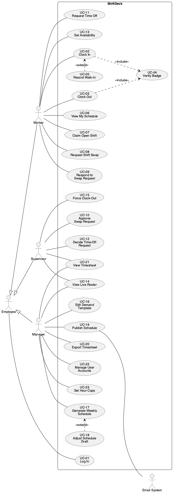

# Use Case Diagram

Three human actors share an abstract **Employee** actor, which owns **UC-01 Log In**. The **Email System** is a secondary actor that receives schedule notifications. The use case IDs (UC-01 … UC-20) are stable, so requirements and test cases can trace to them.

## Use case index

| ID | Use case | Primary actor | FEATURES # |
|---|---|---|---|
| UC-01 | Log In | Employee | 5.1, 5.2 |
| UC-02 | Clock In | Worker | 1.1, 1.3, 1.5 |
| UC-03 | Clock Out | Worker | 1.2 |
| UC-04 | Verify Badge | (included) | 1.1 |
| UC-05 | Record Walk-In | (extends UC-02) | 1.5 |
| UC-06 | View My Schedule | Worker | 2.1 |
| UC-07 | Claim Open Shift | Worker | 2.2 |
| UC-08 | Request Shift Swap | Worker | 2.3 |
| UC-09 | Respond to Swap Request | Worker | 2.3 |
| UC-10 | Approve Swap Request | Supervisor | 2.3 |
| UC-11 | Request Time Off | Worker | 2.5 |
| UC-12 | Decide Time-Off Request | Supervisor | 2.5 |
| UC-13 | Set Availability | Worker | 2.6, 3.2 |
| UC-14 | View Live Roster | Supervisor, Manager | 4.1, 4.2 |
| UC-15 | Force Clock-Out | Supervisor | 1.4 |
| UC-16 | Edit Demand Template | Manager | 3.1 |
| UC-17 | Generate Weekly Schedule | Manager | 3.3 |
| UC-18 | Adjust Schedule Draft | (extends UC-17) | 3.5 |
| UC-19 | Publish Schedule | Manager | 3.4 |
| UC-20 | Export Timesheet | Manager | 4.4 |
| UC-21 | View Timesheet | Supervisor, Manager | 4.3 |
| UC-22 | Manage User Accounts | Manager | 5.3 |
| UC-23 | Set Hour Caps | Manager | 3.2 |

## Associations

| Relationship | Meaning |
|---|---|
| UC-02 Clock In `<<include>>` UC-04 Verify Badge | Every clock-in validates the badge first. |
| UC-03 Clock Out `<<include>>` UC-04 Verify Badge | Every clock-out validates the badge first. |
| UC-05 Record Walk-In `<<extend>>` UC-02 Clock In | Exceptional case: no scheduled shift matches the clock-in. |
| UC-18 Adjust Schedule Draft `<<extend>>` UC-17 Generate Weekly Schedule | Optional: the manager hand-edits the generated draft before publishing. |
| Worker, Supervisor, Manager → Employee | Actor generalization: all three can log in. |

## Primary flows

- **Clock in (Worker).** The worker taps their badge. The system opens a shift, links it to the matching scheduled shift (or records a walk-in), and updates the live roster.
- **Clock out (Worker).** The worker taps again. The system closes the shift and computes duration and lateness.
- **Swap (Worker A → Worker B → Supervisor).** A requests B's slot, B accepts, and a supervisor approves. Both slots are reassigned together.
- **Schedule build (Manager).** Edit the demand template, generate a run, review coverage, adjust if needed, then publish. Affected workers are emailed.
- **Timesheet export (Manager).** Pick a date range and set of workers, then download a CSV for payroll.

The demo simulator is not an actor. It is a development tool, not an external user of the system.

_Source: [`src/use-cases.puml`](./src/use-cases.puml)_
